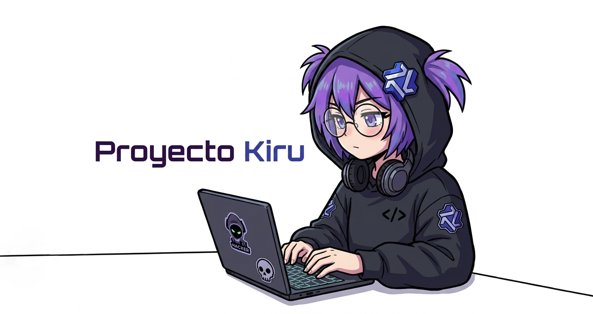

<h1 align="center">Proyecto Kiru — AI & Autonomous Sandbox Studio v2.0</h1>

<p align="center">
  
</p>

<p align="center">
  
  
  
  
  
  
  
  
  
  
</p>

<p align="center">
  Asistente de Inteligencia Artificial local con <b>Control Autónomo de Consola en Sandbox Simulado</b>, <b>Firewall Anti-Destructivo</b>, <b>Planificación Obligatoria de Ejecución</b> e <b>Instalador Oficial de Modelos de HuggingFace (<a href="https://huggingface.co/HauhauCS">HauhauCS</a>)</b> vía Ollama, impulsado por núcleos nativos en <b>Rust</b> y <b>C++20</b> con interfaz gráfica 100% offline.
</p>

---

## ⚡ Prueba Rápida desde el Navegador (Sin Compilar)

Si deseas probar toda la interfaz gráfica de **Kiru**, el **Controlador Autónomo de Sandbox** y el **Instalador de Modelos HauhauCS** directamente en tu navegador **antes de compilar** el código en Rust o C++20, utiliza cualquiera de los lanzadores multiplataforma incluidos:

| Sistema Operativo | Comando / Lanzador Rápido | Descripción |
| :--- | :--- | :--- |
| **Linux / macOS (Bash)** | `./kiru-quick.sh` o `./launchers/kiru-quick.sh` | Levanta el backend rápido en `http://127.0.0.1:5000` y abre el navegador automáticamente. |
| **Windows (PowerShell)** | `.\kiru-quick.ps1` o `.\launchers\kiru-quick.ps1` | Inicia el servidor ligero en Windows PowerShell y lanza el navegador por defecto. |
| **Windows (CMD)** | `kiru-quick.cmd` o `launchers\kiru-quick.cmd` | Script por lotes para Símbolo del Sistema de Windows. |
| **macOS (Finder / DMG)** | `./launchers/kiru-quick.command` / `./launchers/kiru-macos.dmg.sh --build-dmg` | Ejecución con doble clic en macOS o empaquetado de volumen `.dmg` nativo. |

---

## 🛡️ Arquitectura Incrustada de Control Autónomo de Consola (Sandbox)

Kiru incorpora un motor de ejecución autónoma en un entorno simulado de Sandbox (`/tmp/kiru-sandbox` con `KIRU_SANDBOX=1`):

1. **Plan de Ejecución Obligatorio para el Cerebro IA:**
   - Cualquier modelo conectado a Kiru está obligado por directiva de sistema a preparar un **`📋 Plan de Ejecución Autónomo`** antes de proponer o ejecutar comandos, especificando:
     - **🎯 Objetivo / Fin:** Propósito técnico exacto del comando.
     - **🛠️ Herramientas Requeridas:** Binarios y utilidades que necesita (verificados automáticamente en el `PATH`).
     - **⚡ Comando y Propósito:** Explicación detallada de cada parámetro.
2. **Firewall Anti-Destructivo Integrado:**
   - Bloquea estrictamente comandos dañinos contra el sistema operativo: borrado recursivo de raíz (`rm -rf /`, `--no-preserve-root`), formateo o alteración de particiones (`mkfs`, `wipefs`, `fdisk`, `parted`), escritura directa a dispositivos de bloque (`dd of=/dev/*`), *fork bombs*, apagado/reinicio (`shutdown`, `reboot`) y cambios masivos de permisos en `/`.
3. **Uso Controlado de `sudo` con Advertencia de Seguridad:**
   - Desactivado por defecto. Al habilitarlo de forma controlada desde la interfaz, se exige confirmar la siguiente advertencia expresa:
   > *"Darle comandos de superusuario puede resultar en la perdida de archivos importantes, daños, y uso de comandos peligrosos. Solo debe usarse en entorno controlados y comprendiendo por completo los riesgos que puede significar"*

---

## 🤖 Detector de Modelos e Instalador HuggingFace (`HauhauCS`) vía Ollama

Desde la pestaña **Modelos & HauhauCS** (y el selector lateral), Kiru detecta automáticamente los modelos instalados en tu instancia de Ollama (`/api/tags`) y permite instalar con un clic los modelos GGUF sin censura de **[https://huggingface.co/HauhauCS](https://huggingface.co/HauhauCS)** mediante una lista desplegable con los **modelos recomendados hasta arriba** y sus requerimientos completos:

| Modelo (`HauhauCS`) | Disco (SSD) | RAM | VRAM | CPU | Tipo de Equipo en que Corre |
| :--- | :---: | :---: | :---: | :---: | :--- |
| **⭐ #1 Qwen 3.5 4B Uncensored (Recomendado)** | `2.6 GB` | `6 - 8 GB` | `4 GB` (o CPU) | `4 núcleos` | Laptops de uso diario, Mini PCs, GPUs GTX 1650 / RTX 3050 o gráficos integrados. |
| **⭐ #2 Qwen 3.5 2B Uncensored (Recomendado)** | `1.4 GB` | `4 GB` | No requiere GPU | `2 - 4 núcleos` | Ultrabooks ligeras sin GPU dedicada, máquinas virtuales y PCs de bajos recursos. |
| **⭐ #3 Qwen 3.5 9B Uncensored (Recomendado)** | `5.8 GB` | `12 - 16 GB` | `6 - 8 GB` | `6 - 8 núcleos` | PCs Gaming / Desarrollo con RTX 3060 / 4060 o Mac con 16 GB de memoria unificada. |
| **Gemma 4 E2B Uncensored** | `1.6 GB` | `4 GB` | `2 GB` (o CPU) | `4 núcleos` | Portátiles de oficina, Mini PCs y contenedores ligeros. |
| **Gemma 4 E4B Uncensored** | `2.9 GB` | `8 GB` | `4 GB` | `4 - 6 núcleos` | Laptops modernas con 8 GB de RAM y GPUs de entrada. |
| **Qwen 3 VL 8B Uncensored** | `5.4 GB` | `12 GB` | `8 GB` | `6 núcleos` | Equipos de escritorio o laptops gaming con GPU de 8 GB VRAM. |
| **Gemma 4 12B QAT Balanced** | `7.6 GB` | `16 GB` | `10 - 12 GB` | `8 núcleos` | Workstations con RTX 3060 12GB, RTX 4070 o Apple Silicon 16-24 GB. |
| **GPT-OSS 20B Uncensored** | `12.4 GB` | `24 - 32 GB` | `16 GB` | `8 - 12 núcleos` | Estaciones de trabajo con RTX 4060 Ti 16GB, RTX 4080 o Mac 32 GB. |
| **Qwen 3.8 27B Uncensored MTP** | `16.8 GB` | `32 GB` | `20 - 24 GB` | `12 - 16 núcleos` | Workstations entusiastas con RTX 3090 / RTX 4090 (24 GB VRAM). |
| **Qwen 3.6 35B-A3B MoE Uncensored** | `21.0 GB` | `32 GB` | `24 GB` | `12 - 16 núcleos` | Workstations con 32-64 GB RAM DDR5 o GPUs de 24 GB (solo 3B activos por token). |

---

## 🛠️ Compilación Nativa (Rust y C++20)

### Opción 1: Servidor y GUI en Rust (Cargo)

```bash
# Compilar en modo Release optimizado
cargo build --release

# Iniciar el servidor web y WebSocket (http://127.0.0.1:5000)
./target/release/kiru

# O ejecutar auditoría rápida en formato JSON desde la terminal
./target/release/kiru audit
```

### Opción 2: Binario Nativo y CLI en C++20 (CMake)

```bash
# Configurar y compilar el proyecto C++20
cmake -B build-cpp -S .
cmake --build build-cpp

# Ejecutar auditoría de seguridad nativa en JSON
./build-cpp/cpp/kiru-cpp audit

# Iniciar consola interactiva C++ conectada a Ollama, RAG y Sandbox Firewall
./build-cpp/cpp/kiru-cpp
```

---

## 📁 Estructura del Repositorio

```text
Project_Kiru/
├── assets/                       # Recursos gráficos oficiales (Banner y Apariencia)
│   ├── Banner.png
│   └── apariencia.jpeg
├── launchers/                    # Backend rápido sin compilar y lanzadores (.sh, .ps1, .cmd, .dmg)
│   ├── quick_backend.mjs
│   ├── kiru-quick.sh
│   ├── kiru-quick.ps1
│   ├── kiru-quick.cmd
│   ├── kiru-quick.command
│   └── kiru-macos.dmg.sh
├── kiru-quick.sh                 # Acceso directo Linux / macOS
├── kiru-quick.ps1                # Acceso directo Windows PowerShell
├── kiru-quick.cmd                # Acceso directo Windows CMD
├── Cargo.toml                    # Manifiesto de dependencias y compilación Rust
├── CMakeLists.txt                # Configuración raíz de compilación CMake (C++20)
├── LICENSE                       # Licencia MIT
├── src/                          # Código Fuente en Rust (Axum, Sandbox Firewall, Ollama HauhauCS)
├── cpp/                          # Código Fuente en C++20 (Sandbox Firewall, RAG, Pentest)
└── frontend/                     # Interfaz Gráfica 100% Offline (Consola Incrustada + HauhauCS Hub)
```

---

## 📄 Licencia

Este proyecto está distribuido bajo la **Licencia MIT**. Consulta el archivo [LICENSE](LICENSE) para más detalles.
